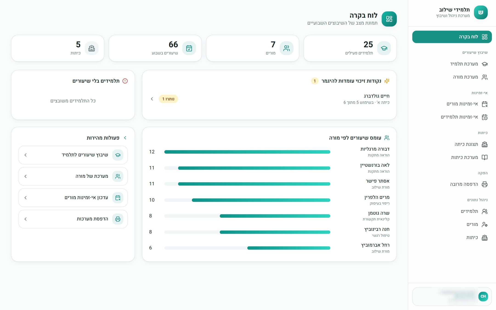
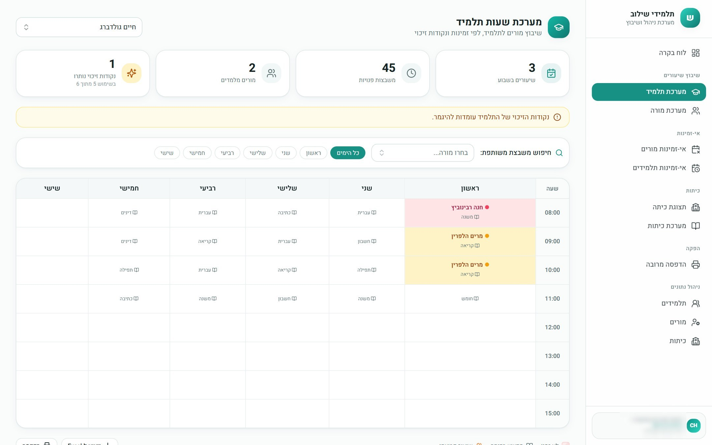
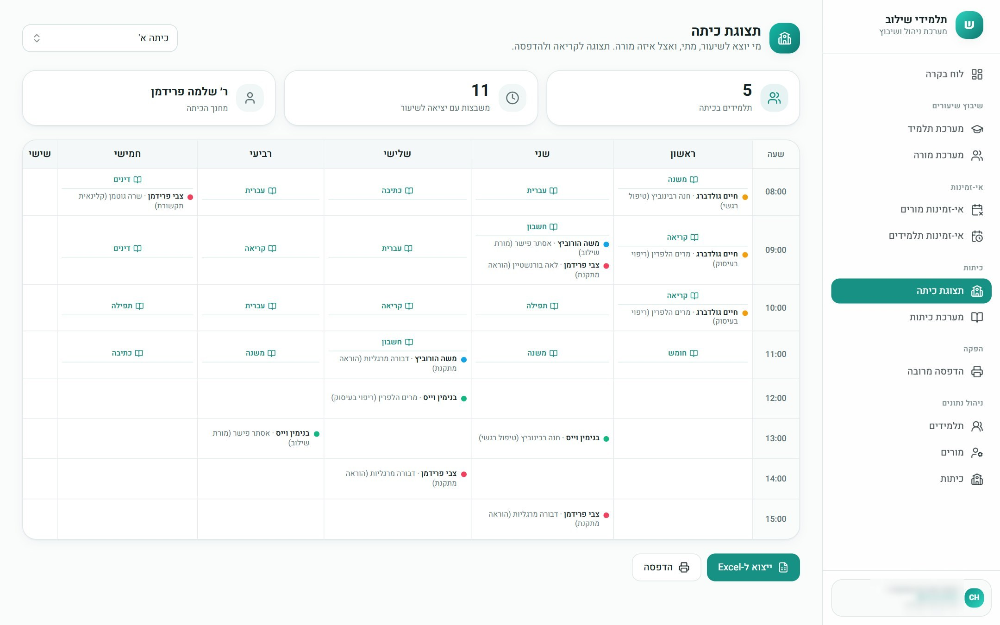
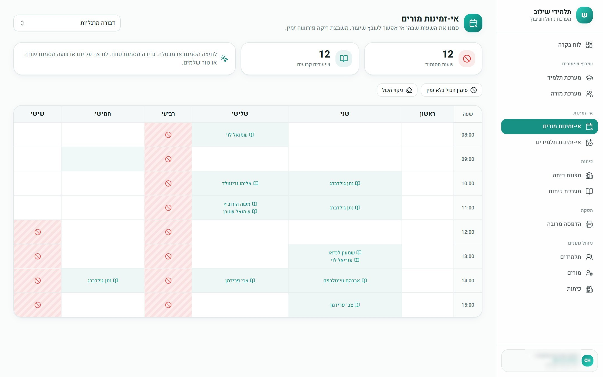
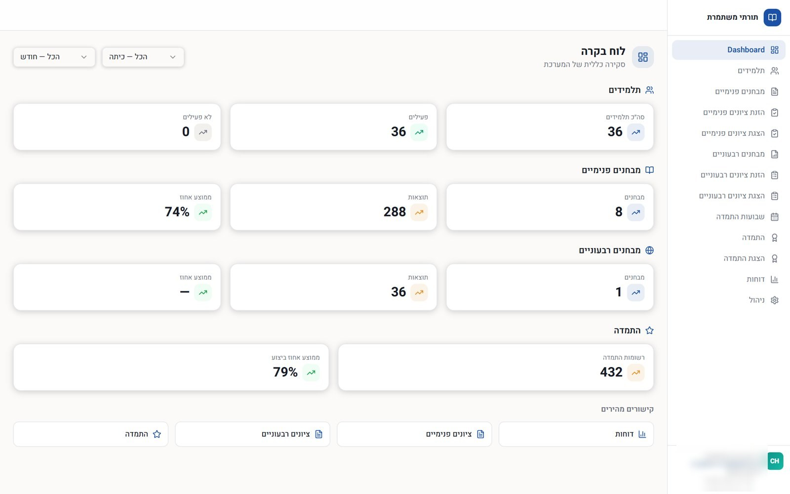
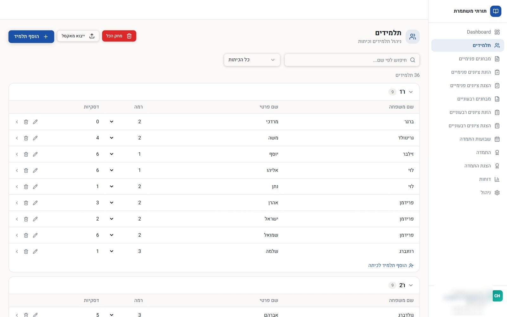
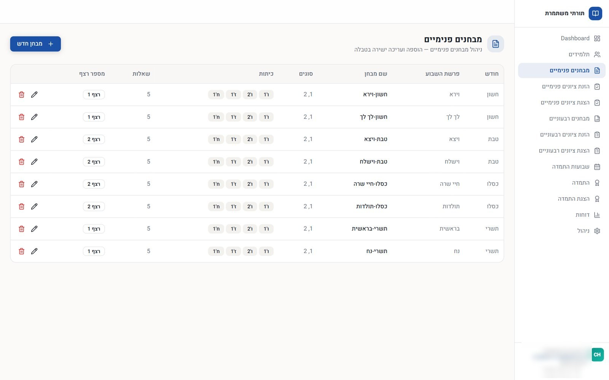
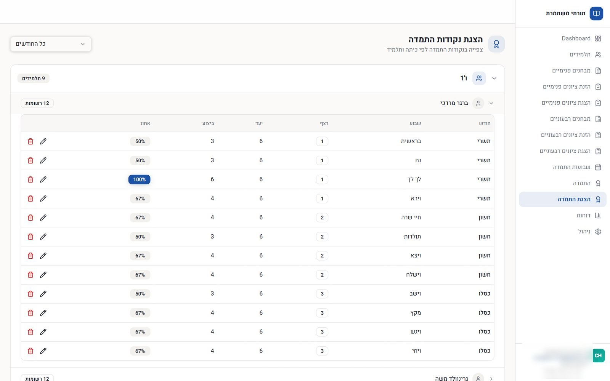
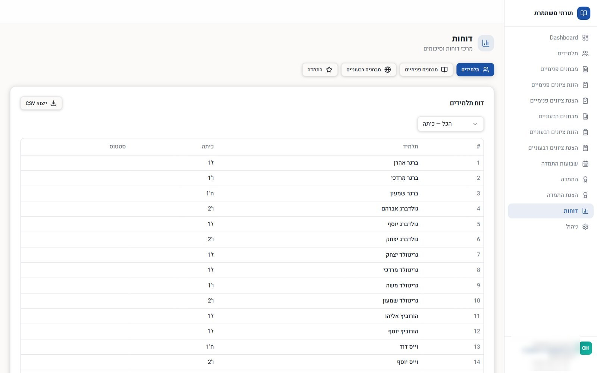

# חיה לסקי – מפתחת Full Stack | AI

הובלתי פיתוח End-to-End של מערכות ענן למוסדות חינוך, מאפיון הדרישות מול הלקוח ועד העלאה לאוויר.
קוד המקור של המערכות שמור במאגרים פרטיים, כי המערכות מנהלות מידע על תלמידים. כאן מוצגים תיאור המערכות, הארכיטקטורה וצילומי מסך מסביבת ההדגמה.

📧 chaya808080@gmail.com

---

## 1. מערכת לניהול תלמידי שילוב

מערכת לשיבוץ שיעורים בין מורים לתלמידות, ניהול זמינות ונקודות זכאות. המערכת רצה בפרודקשן ומנהלת מידע רגיש.

**מה בניתי:**
- **ממשק מלא בעברית מימין לשמאל:** מערכת שעות לתלמיד, למורה ולכיתה, סימון אי-זמינות בגרירה (גם במגע), הדפסה מרובה וייצוא לאקסל.
- **ארכיטקטורה:** שכבת נתונים מופשטת (Repository pattern). אותו קוד רץ גם מול הענן וגם במצב הדגמה מקומי, וממנו נבנית סביבת התנסות נפרדת בלי שום חיבור למסד הנתונים.
- **מסד נתונים:** Postgres עם לוגיקה עסקית בתוך מסד הנתונים (triggers, constraints, פונקציות SQL) ומיגרציות ממוספרות שתואמות לאחור.
- **אבטחה בכמה שכבות:** Row Level Security, גישה רק למשתמשים מורשים, ניהול חיבורים מאובטח והגנות בכל שכבה, ממסד הנתונים ועד הממשק.
- **CI/CD ב-GitHub Actions:** בכל שינוי רצים type check, build, בדיקות אבטחה אוטומטיות על מסד הנתונים, סריקת פגיעויות בספריות וסריקת סודות. הפריסה לפרודקשן אוטומטית ומתבצעת רק כשכל הבדיקות עוברות.
- **תפעול:** גיבוי לילי מוצפן עם בדיקת שחזור אוטומטית.

### צילומי מסך (נתוני הדגמה)

<b>לוח בקרה</b>

<b>מערכת שעות של תלמיד</b>

<b>תצוגת כיתה</b>

<b>סימון אי-זמינות של מורה</b>

---

## 2. מערכת למעקב הישגים לימודיים

מערכת למעקב אחרי מבחנים, ציונים, יעדים שבועיים והישגים של תלמידים, עם דוחות וייצוא נתונים.

**מה בניתי:**
- **מודל נתונים רלציוני מורכב** ב-Postgres, עם טבלאות קישור בין תלמידים, כיתות, מבחנים ויעדים.
- **מנוע חישובים ב-SQL** שמחשב מחדש את כל הערכים הנגזרים בכל שמירה, ברמת דיוק עשרונית.
- **מנוע רצפים לכל כיתה:** מחושב תמיד מהנתונים העדכניים, עם אפשרות לעדכון ידני וסנכרון אוטומטי.
- **שכבת שאילתות מאובטחת:** קריאה בלבד, הגבלת זמן ומספר שורות, ו-Row Level Security על כל הטבלאות.
- **ייבוא מאקסל:** מפענח XLSX ו-CSV שכתבתי בעצמי, בלי ספרייה חיצונית.

### צילומי מסך (נתוני הדגמה)

<b>לוח בקרה</b>

<b>ניהול תלמידים לפי כיתות</b>

<b>מבחנים פנימיים ורצפים לכל כיתה</b>

<b>מעקב התמדה: יעד מול ביצוע</b>

<b>דוחות וייצוא נתונים</b>

---

## פרויקטים נוספים (קוד פתוח)

| פרויקט | תיאור | טכנולוגיות |
|---|---|---|
| [מערכת לסטודיו לאדריכלות](https://github.com/chaya808080/architect-studio) | אתר לקוחות, ממשק ניהול עם מנוע זמינות לקביעת פגישות, וחתימה דיגיטלית על הסכם | ASP.NET Core, EF Core, SQL Server, React, Redux |
| [אקורד: מערכת חכמה לבית ספר לנגינה](https://github.com/chaya808080/akord-music-school) · [הדגמה חיה](https://chaya808080.github.io/akord-music-school/) | שיבוץ אוטומטי, חיזוי נשירה, תחזית הכנסות עם סימולטור, עוזר חכם בעברית, CI/CD עם 80 בדיקות | ‎.NET 8, EF Core, SQL Server, React, TypeScript, Redux |

---

## טכנולוגיות

| תחום | כלים |
|---|---|
| Frontend | React, TypeScript, Vite, Tailwind, React Router, TanStack Query |
| מסד נתונים | PostgreSQL (Supabase), Row Level Security, Edge Functions |
| Backend | C#, ASP.NET Core Web API, Entity Framework Core, SQL Server |
| DevOps | Git, GitHub Actions, Cloudflare Pages |
| ארכיטקטורה | Serverless, Repository pattern, מיגרציות |

